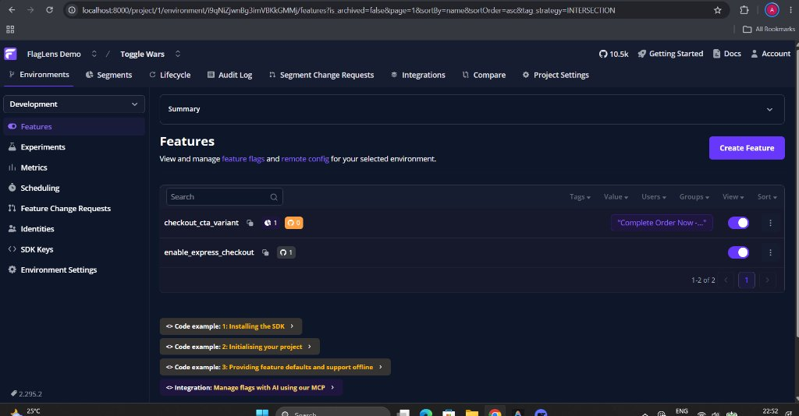

# FlagLens

A VS Code extension for **self-hosted Flagsmith**: see your feature flags next to the code that uses them, toggle them without leaving the editor, and push code references back into Flagsmith. Works in VS Code, Cursor, Antigravity and other VS Code-based editors.

Built for the Toggle Wars hackathon (Track 03: Build on Open Source Flagsmith). The extension lives in [`packages/flaglens-vscode`](packages/flaglens-vscode).

## What FlagLens gives you

- **Sidebar & CodeLens:** See every project, environment, flag value, and code-reference count right above your SDK calls (`hasFeature`, `getValue`, `useFlags`, etc.).
- **Safe toggling & value editing:** Flip flags or edit remote-config values from the sidebar or CodeLens with live state re-reads, v2-versioning protection, and a modal confirmation on production environments.
- **Typo diagnostics & quick fixes:** Unknown flag keys get inline warnings with **Did you mean …?** (Levenshtein ≤ 3) and **Create flag in Flagsmith** quick fixes.
- **Flag Health view:** Surfaces **Unused** (0 refs, 1-click **Archive**), **Missing in Flagsmith** (click to jump to the typo'd line), and **Fully rolled out** flags — plus safe TS/JS/TSX **Remove flag (keep enabled path)** refactoring with diff preview.
- **Code references & CI guardrails:** Push full repository scans to Flagsmith's Code References API (from VS Code or CLI), and catch missing flags in PRs with `flaglens check` and [`.github/actions/flaglens-check`](.github/actions/flaglens-check/action.yml).
- **1-click local stack:** **FlagLens: Start local Flagsmith** + a 4-step getting-started walkthrough.

## Quickstart

Prerequisites: Docker Desktop (running), Node.js 22+, git, and VS Code 1.90+ with the `code` command on your PATH
(VS Code: Command Palette → "Shell Command: Install 'code' command in PATH" if `code` isn't found).

1. **Clone and start self-hosted Flagsmith** (Postgres, API, task processor; image pinned to `2.295.2`):
   ```bash
   git clone https://github.com/abhishekck31/flaglens.git
   cd flaglens
   npm run up
   ```
   Wait for `Flagsmith ready at http://localhost:8000`. The first start pulls images and runs database migrations, so it can take a few minutes.

2. **Create your admin user and an Organisation API key.** Open http://localhost:8000 and sign up (the first user on a new instance is the admin).
   If the dashboard asks you to create an organisation, do so. Then go to Organisation Settings → API Keys → Create API Key, and copy the key.
   It must be an **Organisation** API key: environment (SDK) keys don't work for FlagLens or the seed script.

3. **Seed demo data.** Create the (git-ignored) config file:
   ```bash
   cp flagsmith.env.example flagsmith.env
   ```
   Open `flagsmith.env` and replace `your_organisation_api_key` with your key, so the line reads
   `FLAGSMITH_API_KEY_localhost_8000=<your key>`. Then run:
   ```bash
   npm run seed
   ```
   The seed creates a `Toggle Wars` project with `Development` and `Production` environments and two flags
   (`checkout_cta_variant`, `enable_express_checkout`), and writes `apps/demo-store/.env.local`.

4. **Install the extension** from the [latest release](https://github.com/abhishekck31/flaglens/releases/latest):
   ```bash
   curl -LO https://github.com/abhishekck31/flaglens/releases/latest/download/flaglens-0.3.0.vsix
   code --install-extension flaglens-0.3.0.vsix
   ```
   On Windows PowerShell, type `curl.exe` instead of `curl`. Or download the file in your browser and use
   VS Code: Extensions view → `…` menu → Install from VSIX…

5. **Connect.** Open the cloned folder in VS Code (`code .`), click the **FlagLens** icon in the activity bar, then **Connect to Flagsmith**.
   Keep the default URL `http://localhost:8000/api/v1/` and paste the same Organisation API key.
   The Flags panel shows `Toggle Wars` → `Development` / `Production` with both flags.

6. **Optional: run the demo store,** the app whose flags FlagLens shows:
   ```bash
   npm --prefix apps/demo-store install
   npm run demo
   ```
   Open http://localhost:3000. Open `apps/demo-store/src/components/FlagsmithProvider.tsx` to see CodeLens, hover cards
   and the deliberate `checkout_cta_varient` typo warning.

### Build the extension yourself

```bash
npm --prefix packages/flaglens-vscode install
npm run package   # writes packages/flaglens-vscode/flaglens-<version>.vsix
```

## How FlagLens complements the official code-references scanner

Flagsmith ships an official scanner, the [`Flagsmith/ci`](https://github.com/Flagsmith/ci) GitHub Action. It keeps the dashboard's Code References up to date from CI on every push to `main`. FlagLens works alongside it, in the editor before you commit:

- **CI coverage vs. the editor before commit:** use the Action to keep references current for the whole team. Use FlagLens to see flag state and reference counts while you write the code.
- **Reading references:** FlagLens shows each flag's reference count (from the same API the Action writes to) in the sidebar and in hover cards.
- **Pushing references:** **FlagLens: Push code references to Flagsmith** (the ☁ button in the Flags panel) scans every tracked file in the repository and uploads the result to the same endpoint the Action uses. It matches any quoted string equal to a real flag name, so it also catches `getValue("…")` and `useFlags([…])`. It always uploads the full scan, even an empty one, so references to deleted code clear. Those two gaps in the Action are written up in [`docs/upstream-issue.md`](docs/upstream-issue.md).
  - It respects `.gitignore` (only tracked files are read) and skips files matching the `flaglens.exclude` globs. By default that is build output (`node_modules`, `dist`, `out`, `.next`), tests, Markdown, and setup code that is not real app usage (`stack/**`, `scripts/**`, `**/seed*`).
  - Before uploading, it warns if your commit isn't pushed yet (dashboard permalinks would 404) or you have uncommitted changes, and lets you continue anyway.
  - Afterwards it shows "N references across M flags", lists flags with 0 references, and writes the full list to the **FlagLens** Output panel.
  - Same thing from a terminal: `FLAGLENS_API_KEY=<key> npm --prefix packages/flaglens-vscode run push` (add `--allow-unpushed` to skip the safety stop).
  - Because it uses a plain "quoted name" match, a flag name quoted in a comment counts as a reference.
- **Where it shows up in Flagsmith:** the dashboard (checked on self-hosted 2.295.2) shows a code-reference badge next to each flag on the Features list. In the demo project, `enable_express_checkout` shows **1** and `checkout_cta_variant` shows an orange **0**. The 0 is real: the demo store's only use of that flag is the deliberate typo `checkout_cta_varient`, so the scan finds no reference to the real name. Fixing the typo and pushing references again turns it into 1.
  

## Catch missing flags in CI: `flaglens check`

The same matcher as the editor's typo warnings, as a command line tool (no VS Code needed, Node 22.18+, no install):

```bash
FLAGLENS_API_KEY=<organisation key> npm run check            # text: file:line:col + "Did you mean"
FLAGLENS_API_KEY=<organisation key> npm run check -- --json  # machine-readable
```

It exits **1** if any `hasFeature` / `getValue` / `useFlags([...])` / … key doesn't exist in Flagsmith, **2** on a config or network error, **0** otherwise.
It scans git-tracked files and reads `flaglens.exclude`, `flaglens.callPatterns` and `flaglens.projectId` from `.vscode/settings.json`, so CI and the editor agree.

**GitHub Action:** [`.github/actions/flaglens-check`](.github/actions/flaglens-check/action.yml) runs the check, annotates the offending lines and writes a Markdown report.
[`.github/workflows/flaglens-check.yml`](.github/workflows/flaglens-check.yml) is an example that comments the report on the PR and keeps one comment updated.
Because this demo's Flagsmith runs on a laptop, that workflow starts a throwaway Flagsmith on the runner and seeds it; with your own instance, pass `api-url` and an `api-key` secret instead:

```yaml
- uses: abhishekck31/flaglens/.github/actions/flaglens-check@main
  with:
    api-url: https://flagsmith.example.com/api/v1/
    api-key: ${{ secrets.FLAGSMITH_ORG_API_KEY }}
```

Note: in this repo the demo store keeps its intentional typo, so the check fails on every PR to `main` by design.
Live proof in [PR #1](https://github.com/abhishekck31/flaglens/pull/1): [failing check on the typo](https://github.com/abhishekck31/flaglens/actions/runs/46024569377) → [passing check after fixing it](https://github.com/abhishekck31/flaglens/actions/runs/46024901000).

## Examples across SDKs & cleanup

### 1. TypeScript / React / Python SDK detection

FlagLens matches `hasFeature`, `isFeatureEnabled`, `getValue`, `getFeatureValue`, `getFlag`, and `useFlags([...])` out of the box, and any custom function via `flaglens.callPatterns`:

```ts
// TypeScript / Next.js (apps/demo-store)
const cta = flagsmith.getValue("checkout_cta_variant");
const express = flagsmith.hasFeature("enable_express_checkout");

// React SDK
const flags = useFlags(["checkout_cta_variant", "enable_express_checkout"]);
```

For Python or Go SDKs, add the method name in `.vscode/settings.json` (shared between VS Code and `flaglens check` in CI):

```json
{
  "flaglens.callPatterns": ["hasFeature", "getValue", "useFlags", "is_feature_enabled"]
}
```

```python
# Python SDK — flagged if "new_billing_flow" is missing in Flagsmith
if flags.is_feature_enabled("new_billing_flow"):
    render_v2_billing()
```

### 2. Dead-flag cleanup (`Remove flag (keep enabled path)`)

When a flag is **ON in every environment** (shown under **Flag Health → Fully rolled out**), FlagLens uses the TypeScript compiler API to preview and rewrite the three safe shapes (leaving any non-trivial usage untouched and listing `file:line` for manual review):

```tsx
// 1) Branching statement: if (hasFeature("x")) { A } else { B } → A
if (flagsmith.hasFeature("enable_express_checkout")) {
  showExpressBadge();
} else {
  showStandardCheckout();
}
// Becomes:
showExpressBadge();

// 2) Ternary: hasFeature("x") ? A : B → A
const badge = flagsmith.hasFeature("enable_express_checkout") ? <ExpressBadge /> : null;
// Becomes:
const badge = <ExpressBadge />;

// 3) Constant literal inline (when all environments share the same literal)
const ctaLabel = flagsmith.getValue("checkout_cta_variant");
renderButton(ctaLabel);
// Becomes:
renderButton("Complete Order Now ->");
```

After applying the diff preview, FlagLens offers to archive the flag in Flagsmith (with confirmation).

## License

MIT
